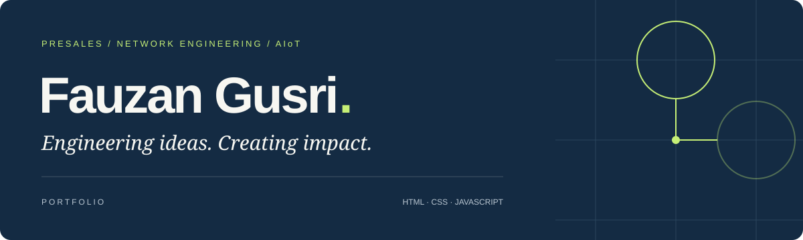

<p align="center"></p>

<h1 align="center">Portfolio</h1>

<p align="center">The personal portfolio of <strong>Fauzan Gusri</strong>.<br>Connecting business needs with practical technology solutions.</p>

<p align="center"><a href="https://fauzangusri.github.io/">View live website ↗</a> · <a href="assets/documents/Fauzan-Gusri-CV.pdf">Download CV</a> · <a href="https://www.linkedin.com/in/fauzangusri">LinkedIn</a></p>

<p align="center">
  
  
  
  
</p>

## About

A responsive portfolio presenting my background in Electrical Engineering, enterprise presales, telecommunications, and AIoT. Built with HTML, CSS, and a small JavaScript enhancement, and hosted on GitHub Pages.

## Explore the website

- **About** — background, education, and selected achievements.
- **Experience** — professional roles and measurable contributions.
- **Skills** — presales, networking, programming, cloud, and AI.
- **Leadership** — team and organizational experience.
- **Contact** — email, LinkedIn, and a downloadable CV.

## Tech stack

| Technology | Role in this project |
| --- | --- |
| **HTML5** | Semantic content, navigation, accessibility labels, and metadata |
| **CSS3** | Navy and lime theme, Grid and Flexbox layouts, and responsive breakpoints |
| **JavaScript** | Automatically updates the footer year |
| **WebP & SVG** | Optimized portrait, favicon, and repository cover |
| **Google Fonts** | DM Sans and Manrope, with system font fallbacks |
| **GitHub Pages** | Static hosting from the `main` branch |

No framework, package installation, build step, or database is required.

## Folder structure

```text
.
├── index.html                  # Portfolio page
├── assets/
│   ├── css/
│   │   └── style.css           # Theme and responsive styles
│   ├── js/
│   │   └── main.js             # Footer year enhancement
│   ├── images/
│   │   ├── fauzan.webp         # Optimized portrait
│   │   └── favicon.svg         # FG monogram
│   └── documents/
│       └── Fauzan-Gusri-CV.pdf # Downloadable English CV
├── robots.txt                  # Search crawler instructions
├── sitemap.xml                 # Canonical page URL for search engines
├── docs/
│   └── cover.svg               # Repository cover artwork
├── .editorconfig               # Editor formatting conventions
├── .gitattributes              # Text and binary file handling
├── .gitignore                  # Local file exclusions
├── .nojekyll                   # Disable Jekyll processing
└── README.md
```

## Run locally

Open `index.html` directly in a browser. To preview over HTTP, run this command from the repository root if Python is installed:

```sh
python -m http.server 8000
```

Then visit `http://localhost:8000`.

## Customize

| To update | Edit |
| --- | --- |
| Profile, experience, skills, and contact | `index.html` |
| Colors, typography, spacing, and mobile layouts | `assets/css/style.css` |
| Browser behavior | `assets/js/main.js` |
| Portrait | `assets/images/fauzan.webp` |
| Downloadable CV | `assets/documents/Fauzan-Gusri-CV.pdf` |

Keep asset paths relative so the website also works from a project subdirectory. All visible website copy is in English.

## Deployment

GitHub Pages publishes the root directory of `main`. Changes pushed to that branch trigger the Pages build and deployment process.

The repository name `fauzangusri.github.io` provides the account-level website address. **Portfolio** is the project title displayed in this README.

## Accessibility

The page includes semantic headings, a skip link, descriptive image text, visible keyboard focus, and reduced-motion support. Layouts adapt to desktop, tablet, and mobile screens.

## Search appearance

The page includes a descriptive title, canonical URL, social sharing metadata, and WebSite, ProfilePage, and Person structured data. `robots.txt` points crawlers to `sitemap.xml`. These signals help search engines understand the website; indexing and the displayed search title are controlled by search engines.

## Contact

[Email](mailto:fauzan.gusri58@gmail.com) · [LinkedIn](https://www.linkedin.com/in/fauzangusri)

---

Content and photographs belong to Fauzan Gusri. Experience and training descriptions are based on the supplied CV.
